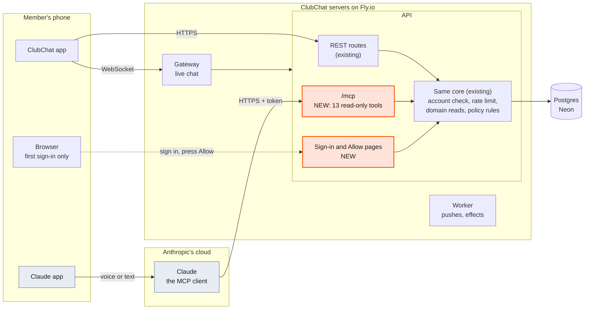
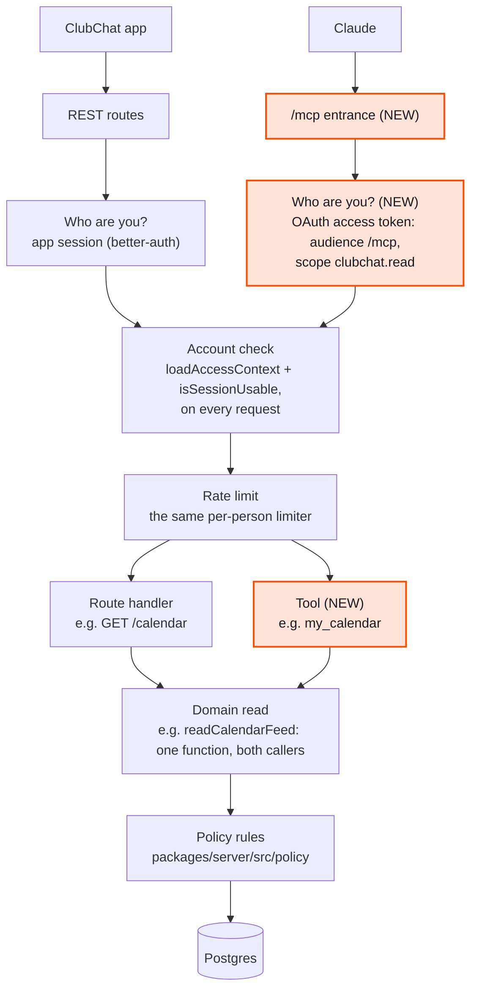
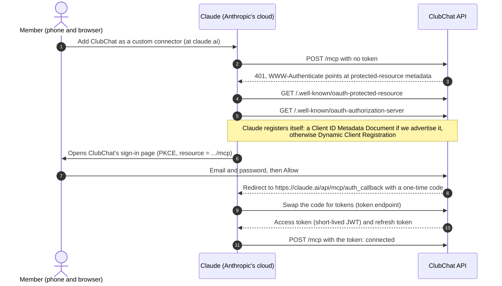
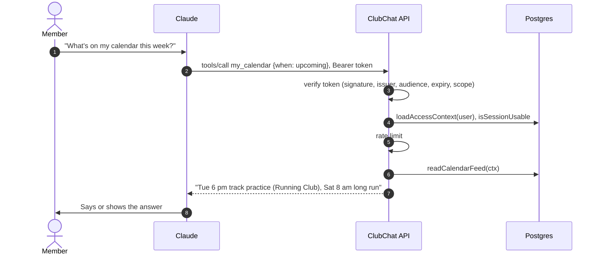

# 2. Architecture

The diagrams below are Mermaid, so they render on GitHub. The same pictures, drawn more carefully,
are in [`visual/clubby-connector.html`](visual/clubby-connector.html).

## 2.1 The three MCP roles, and which one we build

| MCP role | What it is here | Who builds it |
|---|---|---|
| **Host** | The Claude app on the member's phone or computer. Where they type or talk. | Anthropic |
| **Client** | Claude, running in Anthropic's cloud. Picks a tool and calls our server. | Anthropic |
| **Server** | `https://api.clubchatapp.com/mcp`, a new entrance on our API. | **Us** |

**We do not write an MCP client.** Claude is the client, and so is any other MCP-speaking app a
member might use. Remote connectors are called from Anthropic's servers, not from the phone, so our
server must be reachable on the public internet, which the API already is.

## 2.2 Where it fits in the system

**What is new:** the `/mcp` route group, the sign-in and Allow pages, the OAuth metadata documents,
and the tables that hold OAuth clients and tokens. **What is unchanged:** the gateway, the worker,
Redis, R2, the CDN, the mobile app, every read function and every policy rule. No new Fly app and no
new database.

## 2.3 Inside the API: a new entrance, the same building

Today `packages/server/src/api/app.ts` (around lines 551 to 660) runs `authenticate()` (session,
then `loadAccessContext`, then `isSessionUsable`), then the per-user limiter, then the uuid hook,
inside one `protectedRoutes` scope. **`/mcp` must not be registered inside that scope**, because
that scope accepts an app session and `/mcp` must accept only its own OAuth tokens (the MCP spec:
a server "MUST only accept tokens that are valid for use with their own resources"). So `/mcp` gets
its own scope with its own first step, and then **reuses** the same account check and limiter.
Extract the shared half of `authenticate()` into one function both scopes call, rather than
restating it (failure mode 10).

## 2.4 Connecting for the first time

## 2.5 One question

Nothing is written. No read cursor moves, no notification is marked read.

## 2.6 The endpoints

| Path | Method | Who calls it | Purpose |
|---|---|---|---|
| `/mcp` | POST | Claude | MCP over Streamable HTTP, stateless. GET and DELETE answer 405 |
| `/.well-known/oauth-protected-resource` (and the `/mcp`-suffixed form) | GET | Claude | Says which authorization server issues tokens for `/mcp` (RFC 9728) |
| `/.well-known/oauth-authorization-server` | GET | Claude | Authorization server metadata (RFC 8414) |
| authorize, token, register, consent, JWKS | various | Claude, the browser | Provided by the better-auth OAuth provider plugin; exact paths from its docs |
| sign-in page, Allow page | GET, POST | The member's browser | Two plain HTML pages the API serves itself |

Confirm the exact well-known paths against the spec and the plugin at build time. The spec checks
both the root form and the path-suffixed form.

## 2.7 Packages

All server-side. Nothing in `apps/mobile` changes.

| Package | Version on 2026-10-18 | Why |
|---|---|---|
| `better-auth` (and `@better-auth/*`) | 1.6.25 installed, 1.7.10 needed | The OAuth plugins below require `^1.7.10` |
| `@better-auth/oauth-provider` | 1.7.10 | Makes ClubChat an OAuth 2.1 authorization server |
| `better-auth/plugins` `jwt` | with better-auth | Signs access tokens; publishes the JWKS |
| `@better-auth/cimd` | 1.7.10 | Client ID Metadata Documents, which the MCP spec prefers |
| `@modelcontextprotocol/server` | 2.3.1 | The MCP server SDK, v2 (depends on `zod ^4.2.0`; the server is on `^4.4.3`) |
| `@modelcontextprotocol/node` | 2.1.1 | `NodeStreamableHTTPServerTransport` |
| `@modelcontextprotocol/fastify` | 2.0.1 | Fastify helpers; peer `fastify ^5.2.0` (the server is on `^5.10.0`) |

Not used: better-auth's older `mcp` plugin (built on the OIDC provider, no Client ID Metadata
Document support). See [`06-decisions.md`](06-decisions.md) D2.

## 2.8 Proposed files

A proposal for the builder, not a requirement. Mirror the closest existing pattern (AGENTS.md 2.1).

| File | Holds |
|---|---|
| `packages/server/src/auth.ts` | Adds `oauthProvider`, `jwt` and `cimd` to the existing plugin list |
| `packages/server/src/api/routes/mcp.ts` | The `/mcp` scope: token check, shared account check and limiter, hand-off to the transport |
| `packages/server/src/api/routes/oauth-pages.ts` | The sign-in and Allow pages and their form posts |
| `packages/server/src/mcp/server.ts` | Builds an `McpServer` for one request and registers the tools |
| `packages/server/src/mcp/tools/*.ts` | One file per tool or per area, each a thin call into `domain/` |
| `packages/server/src/mcp/speak.ts` | Pure formatting: turning envelopes and feed items into short answers. Unit tested |
| `packages/server/src/db/migrations/00NN_oauth_provider.sql` | The plugin's tables; number claimed per AGENTS.md 2.5 item 7 |
| `packages/server/src/api/plumbing.ts` | `authorizeChannels` refactored to take an `AccessContext`; the HTTP wrapper keeps its signature |

## 2.9 Tokens

- **Access token**: a JWT signed by our JWKS, with `iss` = our auth base URL, `aud` =
  `https://api.clubchatapp.com/mcp`, `sub` = the user id, `scope` = `clubchat.read`. Verified
  locally on every request; no introspection round trip. Short-lived (minutes, not days).
- **Refresh token**: rotated on every use. Claude refreshes on a 401 and up to five minutes before
  expiry, and expects `invalid_grant` when a refresh token is dead.
- **Never trusted on its own**: after the signature, `/mcp` loads the access context and asks
  `isSessionUsable`, so a suspended or deleted account stops on its next call (failure modes 12, 20).
- **Not interchangeable with an app session**, in either direction. Both refusals are proofs in
  [`04-security-and-privacy.md`](04-security-and-privacy.md).

## 2.10 Stateless

One `McpServer` and one transport per request, no MCP session ids. That is the SDK v2 pattern for
a server like this one: it scales with the API machines Fly already runs, needs no sticky routing,
and holds nothing that a deploy could lose.
